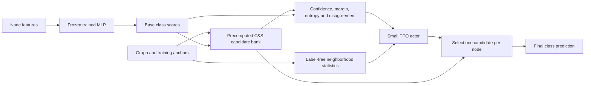
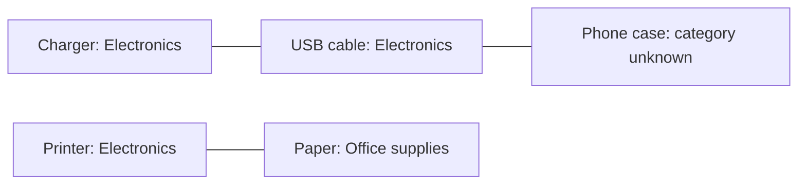
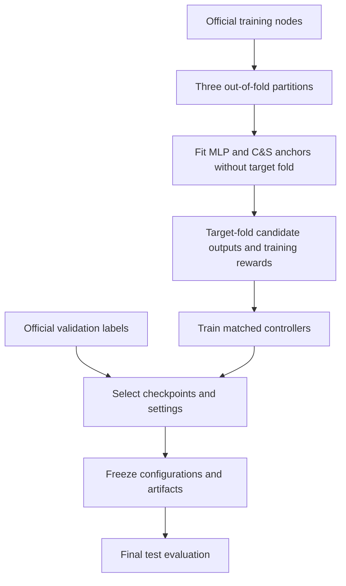

# Learning to Select Correct and Smooth Settings with PPO

**Authors:** Meghana Shanthappa, Chandan, Rishi, and Junhao  
**Status:** Experimental research report · November 2, 2026

## Abstract

Correct and Smooth (C&S) improves node predictions by propagating training-label residuals and class information through a graph. A fixed configuration applies the same settings to every node, despite differences in confidence and neighborhood structure. We investigate a small PPO controller that selects a C&S configuration for each node from a precomputed candidate bank. The revised controller improves ogbn-arxiv test accuracy from 68.804% to 69.064%, a mean paired gain of 0.260 percentage points across three base-model seeds. On ogbn-products, it improves validation accuracy from 91.518% to 91.842%; this revised variant has not been scored on the test set. An earlier, broader Products selector lost 2.467 test percentage points. These mixed results support further study of local configuration selection, without establishing a general advantage for PPO or superiority to simpler learned selectors.

## 1. The problem

A node classifier produces a vector of class scores for each node. The graph provides additional information: connected products may share a category, and connected papers may share a subject. However, connections can also cross categories. One propagation setting may help an uncertain node in a consistent neighborhood while harming a node at a category boundary.

Our question is: **Can a learned per-node selector improve a fixed C&S baseline while respecting the official training-label budget?**

The completed experiments use an MLP as the base classifier. They do not use an LLM, GOFA, or the full GraDBERT leaderboard stack. Earlier exploratory pipelines remain documented separately.

## 2. What Correct and Smooth does

Let P be the base prediction matrix and Y the known one-hot training labels. Correction starts with residuals Y − P on training anchors and zero residuals elsewhere. It propagates these residuals through the graph, reanchoring the known residuals, and adds a scaled correction to P.

Smoothing then replaces the training rows with their known labels and repeatedly mixes neighboring scores with the initial anchored scores. The completed baseline uses 50 correction steps and 50 smoothing steps. Correction uses symmetric degree normalization; smoothing uses row normalization. Exact implementation details are in [MLP_PROTOCOL.md](MLP_PROTOCOL.md).

## 3. Architecture

All candidates are computed globally first. The actor selects one candidate's prediction row for each node. It does **not** modify propagation while it runs, recompute the graph after each selection, or learn a sequential propagation policy. This is a contextual bandit formulation trained with a PPO objective.

### Revised action bank

| Action | Correction scale | Smoothing alpha |
|---|---:|---:|
| Lower correction | 9 | 0.80 |
| Original fixed C&S | 10 | 0.80 |
| Higher correction | 11 | 0.80 |
| Lower smoothing | 10 | 0.75 |
| Higher smoothing | 10 | 0.85 |

All five retain 50/50 propagation steps and correction alpha 1. The settings are close numerically, but this does not guarantee a small change in prediction scores.

The actor receives candidate confidence, top-two margin, entropy, differences from the baseline, predicted-class disagreement, the raw MLP predicted class, and five graph-context statistics. It has one hidden layer of width 32. The state has 87 features on Products and 80 on Arxiv because the number of classes differs.

## 4. Worked example

Consider a hypothetical co-purchase neighborhood:

Consistent neighbors may help classify the phone case. The printer–paper edge illustrates why co-purchase does not always imply the same category. The controller observes confidence and neighborhood statistics and can choose different candidate configurations for these nodes.

The following numbers are **illustrative, not measured experiment outputs**:

| Node | Fixed C&S score for its true class | Alternative candidate score | Desired selection |
|---|---:|---:|---|
| Phone case | 0.58 | 0.66 with higher smoothing | Alternative |
| Printer paper | 0.44 | 0.57 with lower smoothing | Alternative |

True labels in this example explain the outcome; held-out true labels are never controller inputs at inference. The controller must infer useful choices from observable features.

## 5. Learning and label isolation

For action a on policy-training node i, the reward is:

`reward(i,a) = 1[predicted_class(i,a) = true_class(i)] + 0.05 × log(max(p_true(i,a), 1e-8))`

The first term rewards correctness; the second distinguishes candidates with the same predicted class. The actor starts from 20 supervised warm-start epochs, followed by up to 60 continuation epochs. PPO uses sampled actions, clipped probability ratios (clip 0.2), entropy regularization (0.01), and an action-independent expected-reward baseline. Thus the result is for a warm-started PPO pipeline, not PPO trained from scratch.

Because all candidate rewards are available on training examples, direct expected-reward optimization and supervised selection are important controls. PPO is not automatically the most efficient way to solve this problem.

Only official training labels provide controller rewards and C&S anchors. For policy-training examples, the target fold is excluded from both MLP fitting and anchors. Validation labels select checkpoints and hyperparameters. They therefore provide development results, not untouched confirmation. The test set is scored only after the relevant evaluation is frozen; previous Products test exposure is disclosed.

## 6. Results

| Experiment | Evaluation split | Base seeds | Fixed C&S | PPO selector | Paired gain, pp |
|---|---|---:|---:|---:|---:|
| Earlier broad-action Products | Test | 10 | 84.207% | 81.740% | −2.467 |
| Revised small-action Products | Validation | 3 | 91.518% | 91.842% | +0.324 |
| Revised small-action Arxiv | Validation | 3 | 70.426% | 70.748% | +0.321 |
| Revised small-action Arxiv | Test | 3 | 68.804% | 69.064% | +0.260 |

Five actor seeds are averaged within each base-model seed. They are not additional independent graph datasets or independent base models. The Arxiv test gain is positive for all three base seeds. Development scores selected checkpoints and should not be compared directly with official test scores.

### Stronger controls and negative findings

On Arxiv test, the validation-selected best global candidate scores 68.885%; PPO improves on it by approximately 0.178 percentage points. The supervised selector scores 68.989%, and the direct expected-reward controller scores 69.051%, close to PPO's 69.064%. This is insufficient evidence that PPO itself provides a robust advantage over simpler learning objectives.

On Products validation, direct expected-reward optimization scores 91.850%, slightly above PPO's 91.842%. The original broad-action Products test failure remains part of the record. The revised action bank was motivated by that failure; its Products development gains are exploratory.

The original Products fixed baseline reproduces the published MLP+C&S test reference closely: 84.207% versus 84.18%. Products uses 100 official features plus 128 graph-derived spectral features. Arxiv uses standardized official 128-dimensional features without those added spectral features; it is not a reproduction of the strongest published Arxiv C&S configuration. Models are trained independently on each dataset: this is method transfer, not zero-shot transfer of a trained controller.

## 7. Interpretation and remaining work

The supported claim is that this revised selector improves our fixed C&S baseline on the Arxiv test set under the recorded protocol. We have not established a universal improvement, state-of-the-art performance, a unique advantage for PPO, or a completed publication contribution.

Next steps are to compare simpler selectors and tuned fixed settings across more datasets and base seeds, quantify runtime and candidate-bank memory costs, and analyze which nodes benefit. A stronger algorithmic extension would need a new, separately specified protocol. Repeatedly tuning on the existing test results would weaken the evidence.

## 8. Reproducibility and references

See [REPRODUCIBILITY.md](REPRODUCIBILITY.md), [MLP_PROTOCOL.md](MLP_PROTOCOL.md), [SMALL_CS_PROTOCOL.md](SMALL_CS_PROTOCOL.md), [CROSS_DATASET_PROTOCOL.md](CROSS_DATASET_PROTOCOL.md), and the saved summaries in `results/`. Historical source includes machine-specific paths and requires the documented upstream checkouts and separately acquired datasets. This is an experiment archive, not a turnkey portable training package.

- [Correct and Smooth paper](https://arxiv.org/abs/2010.13993) and [original implementation](https://github.com/Chillee/CorrectAndSmooth).
- [Open Graph Benchmark node datasets](https://ogb.stanford.edu/docs/nodeprop/).
- [Proximal Policy Optimization Algorithms](https://arxiv.org/abs/1707.06347).

Author names are listed as supplied by the project owner. No affiliations, author-specific contribution roles, or GitHub account identities are inferred.
