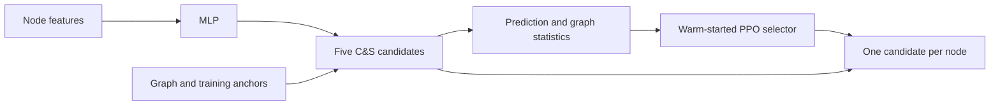

# RL Correct & Smooth

**Learning to select graph post-processing settings for individual nodes.**

**Authors:** Meghana Shanthappa, Chandan, Rishi, and Junhao

This project investigates whether a warm-started PPO controller can improve
Correct and Smooth (C&S) by choosing among precomputed candidate predictions
for each node. The completed experiments use MLP base classifiers on
ogbn-products and ogbn-arxiv.

## Results at a glance

| Experiment | Split | Fixed C&S | PPO + C&S | Gain (percentage points) |
|---|---|---:|---:|---:|
| Revised ogbn-arxiv, 3 base seeds | Test | 68.804% | **69.064%** | **+0.260** |
| Revised ogbn-products, 3 base seeds | Validation | 91.518% | 91.842% | +0.324 |
| Earlier ogbn-products, 10 base seeds | Test | 84.207% | 81.740% | −2.467 |

Five actor seeds are averaged within each base seed. The revised Products
variant has no final-test score. Validation is used for checkpoint selection.
These results do not establish that PPO generally outperforms C&S or simpler
learned selectors.

## How it works

The graph candidates are computed before selection. This is a one-step
contextual decision, not sequential adaptive propagation.

## Read the report

- [Full report: method, worked example, diagrams, results and limitations](PROJECT_REPORT.md)
- [Reproducibility guide](REPRODUCIBILITY.md)
- [Author credits](AUTHORS.md)
- [Saved experiment summaries](results/)

## Implementations

The existing root `rl_correct_smooth.py` is an earlier **sequential REINFORCE
prototype**. It is distinct from the completed PPO experiments and its output
must not be attributed to the reported PPO scores. Its original usage notes
are preserved in [docs/SEQUENTIAL_PROTOTYPE.md](docs/SEQUENTIAL_PROTOTYPE.md).

The completed experiment source is in `experiments/candidate-selection/` in
the GitHub repository. The local research checkout retains those scripts at
its root. The archive includes protocols, source revision records, and tests;
large datasets, trained models, and candidate banks are not bundled. Historical
scripts contain machine-specific paths and require adaptation before reuse.

## Scientific scope

PPO improves our recorded fixed baseline on Arxiv test. Direct expected-reward
optimization performs similarly, and slightly exceeds PPO on revised Products
validation. We retain the earlier negative test result and all control methods.
See the full report for experimental boundaries and remaining work.

## References

- [Correct and Smooth](https://arxiv.org/abs/2010.13993)
- [Original C&S implementation](https://github.com/Chillee/CorrectAndSmooth)
- [Open Graph Benchmark](https://ogb.stanford.edu/docs/nodeprop/)
- [PPO](https://arxiv.org/abs/1707.06347)
